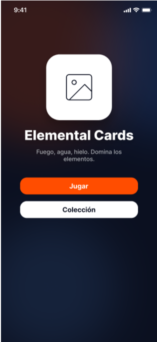
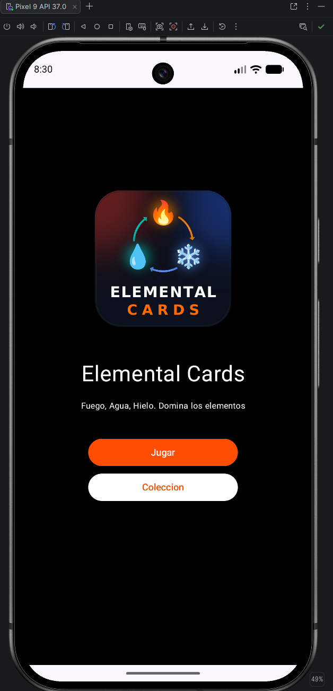
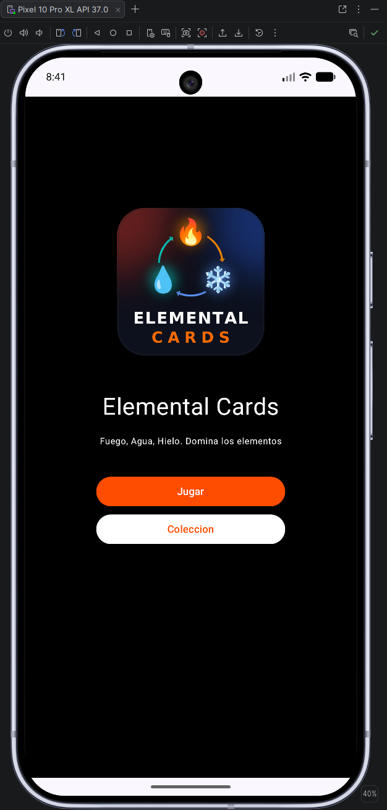
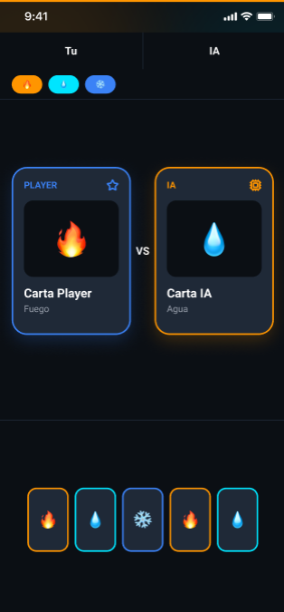
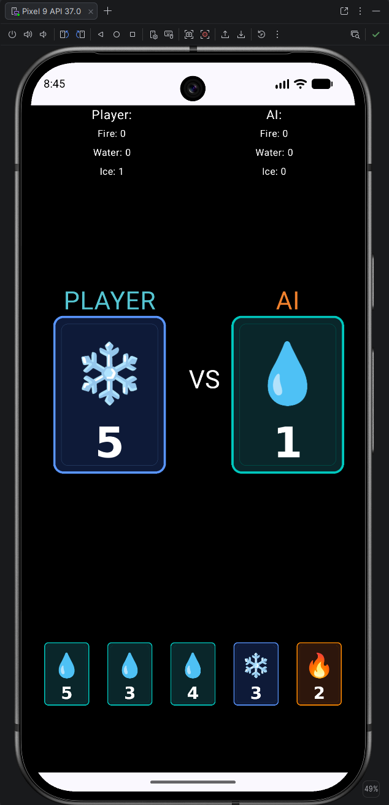
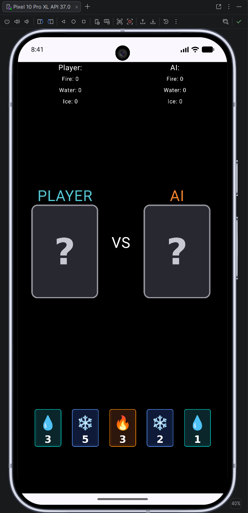
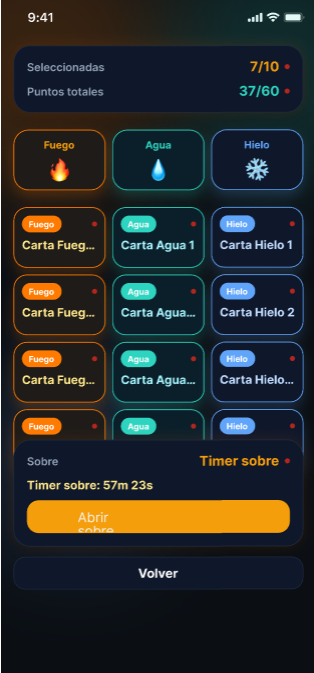
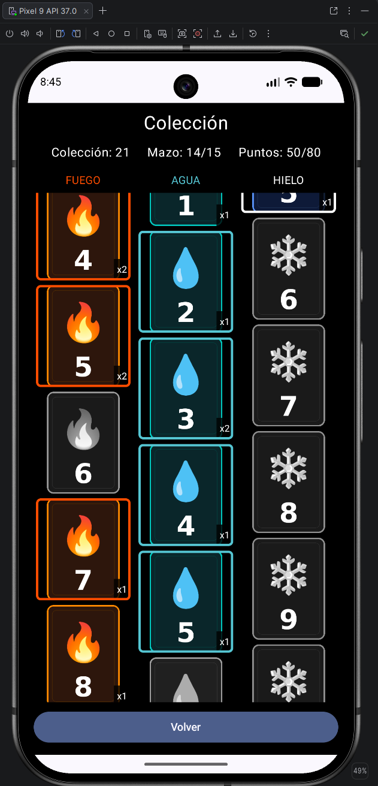

Personal practice project of a card game based on Ninjutsu from Club Penguin

# Alcance de los mockups

Debido a restricciones de tiempo he decidido cambiar y recortar algunos aspectos de la aplicacion.\
El mayor cambio es respecto a la mecanica de los sobres, para tener un gameplayloop mas ameno y recortar la cantidad de pantallas he decidido implementar un sistema que te da una carta como recompensa cuando ganas\
Tambien ha habido varios cambios menores como no usar iconos para los puntajes y usar texto plano para agilizar el proceso\
Ha habido cambios de balance respecto a la primera version, por ejemplo ahora el usuario cuenta con 15 cartas en el mazo y hasta 80 puntos totales\
Tambien he decidio hacer las pruebas en un Pixel 9 y en un Pixel 10 Pro XL para ver diferencias de tamaño en las pantallas

### Comparativa de pantallas:
A continuacion la comparativa de las pantallas, primero mockup, segundo Pixel 9, tecero Pixel 10 Pro XL.

#### Landing Page

<table>
  <tr>
    <td width="33%"></td>
    <td width="33%"></td>
    <td width="33%"></td>
  </tr>
</table>

#### Battle Screen
<table>
  <tr>
    <td width="33%"></td>
    <td width="33%"></td>
    <td width="33%"></td>
  </tr>
</table>

#### Collection Screen
<table>
  <tr>
    <td width="33%"></td>
    <td width="33%"></td>
    <td width="33%"></td>
  </tr>
</table>

USO DE IA:
- Los sprites de las cartas y el logo de inicio fueron generados con Claude.
- La clase CardArt para poder mostrar los rates de las diferentes cartas creando la funcion painter fue creada con la ayuda de Gemini ya que no sabia como imeplementar esta funcion
- El PopUp al terminar la batalla fue creado con ayuda de claude para poder entender y implementar la logica necesaria y la vista relacionada con el PopUp
- Ayuda en la refactorizacion del DAO, repositorio y view model para preparar la feature de coleccion (rama feature/updateData) (github copilot)
- El ultimo gran cambio que fue la creacion de la pantalla de collection con la logica necesaria en data y viewmodel fue hecho usando CopilotGithub como agente.\
Primero cree unos archivos copilot-instructions-md y SKILL.md encontrados bajo la carpeta .github de la raiz, aqui se detallan todas las instrucciones y restricciones del agente\
Tras varias iteraciones en las que pedi al agente que ejecutara las tareas y fui revisando manualmente el codigo que me daba, se llego al resultado final en el proyecto situado bajo la rama feature/colecction
